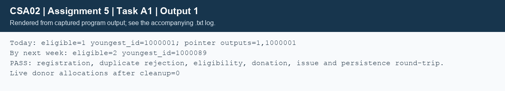

## Task A1 - Functional decomposition and interfaces (7 marks)
### A1.1 - Responsibilities and structure chart
The program separates domain rules (`bank.c`), Gregorian dates (`date.c`), persistence (`storage.c`) and executable drivers. `register_donor` validates a record, rejects duplicate IDs and inserts into ID order. `record_donation` checks the demonstration eligibility rule, adds one stock unit and updates the date. `update_stock` rejects insufficient stock and integer overflow. The CLI provides find, issue and stock commands; the A1 driver exercises registration and donation through the same module API.
```structure_chart
main / command dispatcher
  +-- parse_unsigned, parse_date, group_index
  +-- load_donors / load_stock
  |     +-- read_line / parse_donor / donor_valid
  |     +-- add_donor -> realloc
  +-- register_donor -> donor_valid -> digital_root
  |     +-- add_donor -> realloc
  +-- find_eligible -> eligible_on -> date_ordinal
  +-- record_donation -> eligible_on + update_stock
  +-- issue_file -> fseek + fread + fwrite
  +-- save_donors / save_stock -> fprintf / fwrite
  +-- list_free -> free
```
```text
ALGORITHM Register_Donor
INPUT: mutable list L, read-only donor D
OUTPUT: success or failure
BEGIN
    IF D is invalid THEN RETURN failure END IF
    position <- LOWER_BOUND(L, D.id)
    IF position holds D.id THEN RETURN failure END IF
    copy <- D
    old_size <- L.size
    IF Add_Donor(L, copy) fails THEN RETURN failure END IF
    SHIFT records [position, old_size) one place right
    L[position] <- copy
    RETURN success
END

ALGORITHM Record_Donation
INPUT: mutable donor list L, mutable stock S, ID, date T
OUTPUT: success or failure
BEGIN
    FIND D with the requested ID
    IF no D OR not Eligible_On(D, T) THEN RETURN failure END IF
    IF Update_Stock(S, D.group, +1) fails THEN RETURN failure END IF
    D.last_donation <- T
    RETURN success
END
```
### A1.2 - Prototypes and parameter decisions
`common/bank.h` and `common/date.h` contain the public prototypes below. A C pointer itself is passed by value; the pointed-to object can be changed through a non-const pointer. Array parameters decay to pointers. Small scalars and the 12-byte Date are copied by value. Donor records and lists are passed by pointer to avoid copying their contents or losing ownership changes.
```c
int group_index(const char *group);
unsigned digital_root(unsigned long long value);
bool donor_valid(const Donor *donor);
void list_init(DonorList *list,Allocator *allocator);
void list_free(DonorList *list);
int add_donor(DonorList *list,const Donor *donor);
int register_donor(DonorList *list,const Donor *donor);
bool eligible_on(const Donor *donor,Date on);
Eligible find_eligible(const DonorList *list,const char *group,Date on);
void find_eligible_out(const DonorList *list,const char *group,Date on,size_t *count,int *youngest_id);
int *lowest_stock(int stock[],size_t count);
int update_stock(int stock[GROUP_COUNT],int group,int delta);
int record_donation(DonorList *list,int stock[GROUP_COUNT],int id,Date on);
bool parse_date(const char *text,Date *out);
bool parse_unsigned(const char *text,unsigned maximum,unsigned *out);
Date date_from_ordinal(int ordinal);
Date date_add(Date date,int days);
int save_donors(const char *path,const DonorList *list);
int load_donors(const char *path,DonorList *list);
int save_binary_donors(const char *path,const DonorList *list);
int load_binary_donors(const char *path,DonorList *list);
int save_stock(const char *path,const int stock[GROUP_COUNT]);
int load_stock(const char *path,int stock[GROUP_COUNT]);
int issue_file(const char *path,int group,unsigned units);
int update_binary_donor(const char *path,size_t index,const Donor *donor);
bool same_donor(const Donor *a,const Donor *b);
Donor make_donor(unsigned sequence,Date today);
bool date_valid(Date d);
int date_ordinal(Date d);
```

| Functions / parameter names | Mode and justification |
|---|---|
| group_index(group), parse_date(text,out), parse_unsigned(text,maximum,out) | Strings are const char pointers; parser output pointers are mutable. Maximum is copied. Parsing failure leaves output unchanged. |
| digital_root(value), date_valid(d), date_ordinal(d), date_from_ordinal(ordinal), date_add(date,days) | Scalar or small Date values; no caller mutation. Ordinal conversion/date addition require an in-range date/result. |
| donor_valid(donor), same_donor(a,b) | const Donor pointers: inspect complete records without modifying or copying them. |
| list_init(list,allocator), list_free(list) | Mutable list pointer updates ownership. Allocator pointer is mutable for counters; it must outlive the list. Free resets data/size/capacity. |
| add_donor(list,donor), register_donor(list,donor) | Mutable list, const donor. Copy the donor before realloc so aliases into the old allocation are safe. add_donor appends; register_donor preserves sorted IDs. |
| eligible_on(donor,on), find_eligible(list,group,on) | Read-only donor/list/group pointers and a by-value date; no data modification. |
| find_eligible_out(list,group,on,count,youngest_id) | Same read-only inputs, plus mutable output pointers. This implementation accepts NULL to omit an output. |
| lowest_stock(stock,count), update_stock(stock,group,delta) | Mutable stock pointer enables updating the selected element. Length/group/delta are copied. Lowest returns NULL for an empty array. |
| record_donation(list,stock,id,on) | Mutable list and stock pointers change two in-memory objects; ID and Date copied. |
| read_line(file,buffer,capacity) | FILE pointer changes stream position; mutable buffer receives text; capacity copied and bounds checked. |
| save_donors(path,list), save_binary_donors(path,list), save_stock(path,stock) | Path and list/stock are const: save observes caller data but writes an external file. |
| load_donors(path,list), load_binary_donors(path,list), load_stock(path,stock) | const path plus mutable output. Donor loads stage into a temporary list and preserve the old list on failure. |
| issue_file(path,group,units), update_binary_donor(path,index,donor) | const path/donor, by-value selector and quantity; modify an external file, not the input record. |
| make_donor(sequence,today) | By-value fixture inputs; return an independently owned Donor structure by value. |

Private storage helpers have prototypes `static int invalid(const char *context)` and `static bool parse_donor(char *line, Donor *d)`. The first reads a message; the second splits a mutable line and fills an output record. The command driver uses `static int usage(void)` and `int main(int argc, char **argv)`; argv strings are only read. Experiment-only helpers are local to their C files, with full definitions in the source appendix.

### A1.3 - Returning two results
```text
ALGORITHM Find_Eligible_Struct
INPUT: read-only list L, group G, date T
OUTPUT: structure {count, youngest_id, youngest_age}
BEGIN
    result <- {0, 0, 0}
    FOR each donor D in L DO
        IF D.group = G AND Eligible_On(D, T) THEN
            IF result.count = 0 OR D.age < result.youngest_age
               OR (D.age = result.youngest_age AND D.id < result.youngest_id) THEN
                result.youngest_id <- D.id
                result.youngest_age <- D.age
            END IF
            result.count <- result.count + 1
        END IF
    END FOR
    RETURN result
END

ALGORITHM Find_Eligible_Pointers
INPUT: L, G, T, output addresses count_out and id_out
OUTPUT: values written through valid output addresses
BEGIN
    result <- Find_Eligible_Struct(L, G, T)
    IF count_out is not NULL THEN *count_out <- result.count END IF
    IF id_out is not NULL THEN *id_out <- result.youngest_id END IF
END
```
Both designs scan once: O(n) time and O(1) extra space. The small returned structure is easy to name and cannot suffer mismatched output addresses. Pointer outputs are useful when callers want to omit fields, but add NULL and aliasing decisions. Zero count and ID zero mean no match; ties use the smaller ID. The driver confirms both interfaces agree.

A global-variable alternative stores `DonorList donors`, `int stock[8]`, `count` and `youngest_id` at file scope and uses `find_eligible_global(group,date)`. The scan remains O(n) and the dataset remains O(n) storage; only a constant-size argument/result mechanism changes. Hidden dependencies increase coupling, prevent independent banks from being processed without resetting state, complicate concurrent calls and make tests order-dependent. Passing explicit pointers retains the same asymptotic cost and makes ownership and mutation visible.

Executed evidence: `TaskA1/demo.c`, `TaskA1/output.txt`; registration, duplicate rejection, eligibility today/next week, donation, repeated-donation rejection, issue rejection and text/binary reload all passed.



