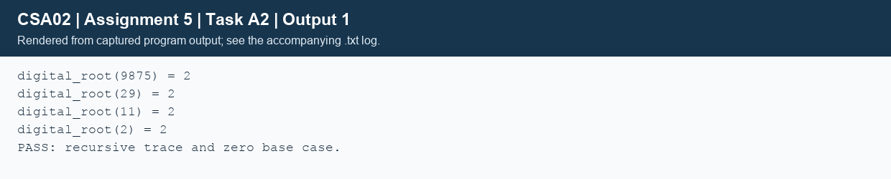

## Task A2 - Recursive designs and traces (5 marks)
### A2.1 - Digital root and halving power
For IDs, the final decimal digit equals the digital root of the preceding digits. For example, body 100000 has root 1, hence ID 1000001. The following designs assume a nonnegative integer and a nonnegative exponent. Power inputs must fit the selected integer representation; the execution tests use bounded values and base 1 for large exponents.
```text
ALGORITHM Digital_Root
INPUT: nonnegative integer N
OUTPUT: one decimal digit
BEGIN
    IF N < 10 THEN RETURN N END IF
    sum <- 0
    WHILE N > 0 DO
        sum <- sum + (N MOD 10)
        N <- N DIV 10
    END WHILE
    RETURN Digital_Root(sum)
END

ALGORITHM Power_Fast
INPUT: base B, nonnegative exponent N
OUTPUT: B raised to N
BEGIN
    IF N = 0 THEN RETURN 1 END IF
    half <- Power_Fast(B, N DIV 2)
    IF N MOD 2 = 0 THEN RETURN half * half END IF
    RETURN half * half * B
END

ALGORITHM Power_Linear
INPUT: B, N
OUTPUT: B raised to N
BEGIN
    IF N = 0 THEN RETURN 1 END IF
    RETURN B * Power_Linear(B, N - 1)
END
```
The digital-root base case is a single digit, including zero. The recursive case first sums the digits. Power has base case N=0; halving computes the child exactly once. The convention 0^0=1 is explicit for this exercise.
### A2.2 - Deepest stacks, return values and recurrences
```stack_diagram
Digital root 9875             Power_Fast(2,13)
BOTTOM: root(9875)            BOTTOM: power(2,13)
        root(29)                     power(2,6)
        root(11)                     power(2,3)
TOP:    root(2)               TOP-1:  power(2,1)
                               TOP:  power(2,0)
Returns: 2 -> 2 -> 2 -> 2    Returns: 1 -> 2 -> 8 -> 64 -> 8192
```
For 9875: 9+8+7+5=29, 2+9=11, 1+1=2. Four calls remain live at the deepest point. Linear power for 2^13 has frames 13,12,...,1,0: 14 calls and return values 1,2,4,...,8192. Fast power has five frames for exponent 13.

Counting the initial and base-case calls: L(0)=1 and L(n)=1+L(n-1), so L(n)=n+1. F(0)=1 and F(n)=1+F(floor(n/2)), so F(n)=floor(log2(n))+2 for n>=1. Linear time/stack are O(n); fast time/stack are O(log n), under fixed-width, constant-time multiplication.

If D is the number of decimal digits, the first digital-root digit pass is O(D), the next has at most O(log D) digits, then smaller passes. Total digit-processing time is O(D). With iterative digit summation inside each call, stack depth is the number of repeated digit sums, much smaller than D (bounded by O(D); more tightly O(log-star N) over unbounded mathematical integers). For the finite unsigned-long-long domain, the depth is small. A version recursively processing each individual digit instead would have O(D) stack.
### A2.3 - Risks and alternatives
Without a terminating base case, or with a recursive argument that does not approach it, calls exhaust the stack. C does not guarantee tail-call elimination. Use a loop for potentially unbounded linear recursion and use halving when the recurrence supports it. Stack growth is separate from numeric overflow: 2^10000 overflows long long even if its recursion fits.
```text
ALGORITHM Digital_Root_Loop
INPUT: nonnegative N
OUTPUT: digital root
BEGIN
    WHILE N >= 10 DO
        sum <- 0
        WHILE N > 0 DO
            sum <- sum + N MOD 10
            N <- N DIV 10
        END WHILE
        N <- sum
    END WHILE
    RETURN N
END

ALGORITHM Digital_Root_Formula
INPUT: nonnegative N
OUTPUT: digital root
BEGIN
    IF N = 0 THEN RETURN 0 END IF
    RETURN 1 + (N - 1) MOD 9
END
```
The loop uses O(D) digit-processing time and O(1) stack. The formula is O(1) time/space for machine integers; arbitrary-precision modulo is not necessarily O(1). The zero guard also prevents unsigned underflow at N-1. `TaskA2/design_check.c` confirms the trace values; B1 adds edge cases and measured calls.



