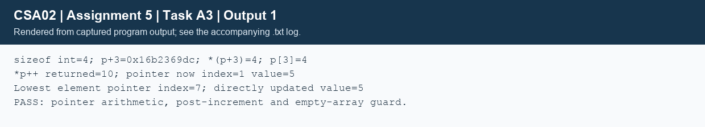

## Task A3 - Pointer operations and CLI (5 marks)
### A3.1 - Pointer memory diagram
For `int stock[8]={10,5,8,4,7,3,6,2}; int *p=stock;`, measured sizeof(int)=4 on this system. B denotes the base address, so pointer arithmetic scales by four bytes.
```pointer_diagram
Index:       0    1    2    3    4    5    6    7
Group:      O+   O-   A+   A-   B+   B-  AB+  AB-
Value:      10    5    8    4    7    3    6    2
Address:     B  B+4  B+8 B+12 B+16 B+20 B+24 B+28
             ^              ^
          initial p        p + 3
After evaluating *p++: returned value = 10; p = B + 4.
```
`p+3` points at stock[3] without changing p; `*(p+3)` and `p[3]` both read 4. Postfix increment binds more tightly than `*`, so `*p++` means `*(p++)`: read the old pointed-to element and advance p by one int. It does not increment the stock value. These expressions are considered with the original p, except the explicitly shown post-increment. Pointer arithmetic must stay within the same array or its one-past position; one-past must not be dereferenced.
### A3.2 - Returning a safe element pointer
```text
ALGORITHM Lowest_Stock
INPUT: mutable array S, length N
OUTPUT: pointer to first minimum element, or NULL
BEGIN
    IF S is NULL OR N = 0 THEN RETURN NULL END IF
    best <- ADDRESS(S[0])
    FOR i <- 1 TO N - 1 DO
        IF S[i] < *best THEN best <- ADDRESS(S[i]) END IF
    END FOR
    RETURN best
END
```
The caller can use `int *p=lowest_stock(stock,8); if(p) *p+=3;`. The program selected index 7 and changed its value from 2 to 5. Returning `&local_minimum` would be invalid after the function returns because the local object's lifetime ends. Returning a pointer into the caller's still-live array is valid. A stock increment still needs a range/overflow check in a real update; the demonstrated 2+3 is bounded.

The index alternative returns `SIZE_MAX` for an empty array and otherwise the first minimum index. The caller checks `i != SIZE_MAX && i < count` before using `stock[i]`. Both alternatives require O(n) time and O(1) extra storage. After successful realloc, a saved element pointer is invalid even if the allocation appears unchanged. A saved index can be reapplied to the new base if the record remains at that index; insertions/deletions may still change its meaning.
### A3.3 - Command-line contract
```text
ALGORITHM Dispatch
INPUT: argc and argv
OUTPUT: printed result and process status
BEGIN
    IF argc < 2 THEN PRINT usage; RETURN 2 END IF
    IF command = "find" THEN
        REQUIRE argc = 5, valid group, valid YYYY-MM-DD
        LOAD donors; FIND eligible donors; PRINT count and youngest ID
    ELSE IF command = "issue" THEN
        REQUIRE argc = 5, valid group, integer units in [1, INT_MAX]
        UPDATE selected binary stock record
    ELSE IF command = "stock" THEN
        REQUIRE argc = 3; LOAD and PRINT all eight stock values
    ELSE PRINT usage; RETURN 2
    END IF
    ON file/data failure: PRINT perror message; RETURN 1
    FREE any owned donor allocation
    RETURN 0
END
```
Exact examples: `build/bloodbank find data/donors_1000.tsv O+ 2026-11-18`, `build/bloodbank issue build/readonly.bin A- 2`, `build/bloodbank stock data/stock.bin`. File paths and the reporting date are explicit so runs can be reproduced. Strict parsing rejects signs, trailing characters, overflow, invalid dates and unknown groups. Argument counts are checked before indexing later argv entries; shell quoting supports paths with spaces. B2 records the missing/extra/invalid argument cases.



