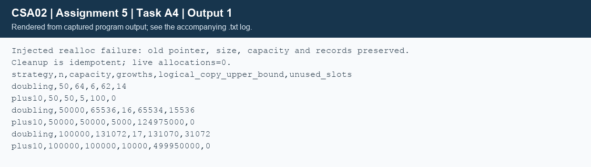

## Task A4 - Growable storage and ownership (4 marks)
### A4.1 - Doubling with failure safety
The invariant is 0 <= size <= capacity <= 1,000,000. Only `list_free` owns cleanup. Appending does not require sorted IDs; registration and file loading enforce ID order. The richer Donor extends the supplied ID/group exercise with the fields needed by eligibility reporting, while retaining its same doubling/realloc algorithm.
```text
ALGORITHM Add_Donor
INPUT: mutable list L, valid donor D
OUTPUT: success or failure
BEGIN
    IF D is invalid OR L.size = MAX_DONORS THEN RETURN failure END IF
    copy <- D
    IF L.size = L.capacity THEN
        IF L.capacity = 0 THEN new_capacity <- 2
        ELSE new_capacity <- MIN(2 * L.capacity, MAX_DONORS)
        END IF
        IF new_capacity > SIZE_MAX DIV SIZEOF(Donor) THEN
            RETURN failure
        END IF
        p <- REALLOC(L.data, new_capacity * SIZEOF(Donor))
        IF p is NULL THEN RETURN failure END IF
        L.data <- p
        L.capacity <- new_capacity
    END IF
    L.data[L.size] <- copy
    L.size <- L.size + 1
    RETURN success
END
```
The one-million cap makes integer doubling safe in the tested int representation; byte-size overflow is separately checked. Copying D before realloc handles D pointing inside the original array. On failure, realloc leaves the old allocation valid: size, capacity, pointer and records must remain unchanged. The injected-failure test confirms that invariant and then retries successfully.
### A4.2 - Three memory errors
| Error | Blood-bank example | Prevention |
|---|---|---|
| Leak | Assigning `list.data=realloc(list.data,bytes)` loses the only old pointer when allocation fails. | Use temporary p; adopt only on success. Free temporary lists on malformed input. |
| Dangling pointer | Cache `Donor *d=&list.data[0]`, grow the list, then use d after realloc invalidates it. | Retain an ID/index and resolve again; copy aliasing inputs before resize. Never return an automatic local's address. |
| Double free | Both a copied DonorList and its original believe they own the same data pointer. | Keep a single owner, transfer ownership explicitly, and reset after free. Do not shallow-copy owners for independent cleanup. |

The implementation's allocator tracks live owned donor buffers. `list_free` is idempotent on the same reset list; it does not make two stale shallow copies safe.
### Alternative: grow by ten
Replace doubling with `new_capacity=capacity+10`, retaining the temporary pointer and overflow checks. For n=10k, possible copied records sum to 10(0+1+...+k-1)=5k(k-1), hence O(n^2) overall. With doubling from 2, the old capacities form 2+4+...+C/2=C-2<2n, hence O(n) total copying and amortized O(1) append. A single growth can still be O(n).

| Strategy | n | Final capacity | Growth calls | Potential records copied | Unused slots |
|---|---|---|---|---|---|
| Double | 50 | 64 | 6 | 62 | 14 |
| Add 10 | 50 | 50 | 5 | 100 | 0 |
| Double | 50,000 | 65,536 | 16 | 65,534 | 15,536 |
| Add 10 | 50,000 | 50,000 | 5,000 | 124,975,000 | 0 |
| Double | 100,000 | 131,072 | 17 | 131,070 | 31,072 |
| Add 10 | 100,000 | 100,000 | 10,000 | 499,950,000 | 0 |

These counts were produced by the growth simulation in `TaskA4/growth.c`; they are logical upper bounds if each realloc moves the buffer, not a measurement of physical copying. Add-ten wastes at most 9 slots after a successful append (10 immediately after growth before insertion); doubling wastes fewer than n slots after insertion (roughly half its capacity immediately after growth). Both use O(n) allocated space. Sorted registration also shifts records, so its O(n) insertion cost remains even though append allocation is amortized O(1).



