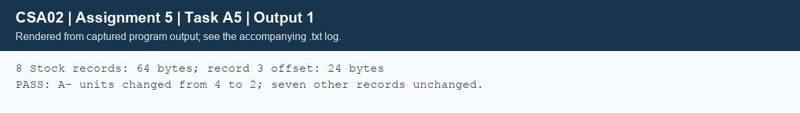

## Task A5 - Persistent text and binary formats (4 marks)
### A5.1 - Storage design and round-trip rules
Donor text starts with the schema header `DONORS\t1`, followed by one tab-separated record per line: ID, name, group, age, phone, YYYY-MM-DD and hospital. `fprintf` makes records readable and easy to export. Names may contain spaces but not control characters/tabs; lengths, checksums, dates and IDs are validated. Loading demands strictly increasing IDs, rejects duplicates/truncation, and only replaces the active list after complete success.

Stock uses eight fixed records `struct {int group_code; int units;}` in the declared group order. Measured sizeof(Stock)=8; the file is 64 bytes. `fwrite` writes the array; `fread` validates all eight records and rejects extra bytes. Native struct files are suitable only for the same compiler/ABI in this exercise: integer widths, byte order and padding are not a portable external format.
```text
ALGORITHM Save_Donors_Text
INPUT: path P, read-only list L
OUTPUT: success or failure
BEGIN
    OPEN P for text writing; IF failure THEN perror; RETURN failure END IF
    WRITE schema header using fprintf
    FOR each D in L DO
        WRITE D fields and newline using fprintf
        IF write fails THEN CLOSE file; RETURN failure END IF
    END FOR
    CHECK fclose result
    RETURN success only if all operations succeeded
END
```
### A5.2 - One-record update
```file_diagram
Binary stock, 8 bytes per record on this host:
Index       0       1       2       3       4 ... 7
Offset      0       8      16      24      32 ... 56
         [ O+ ]  [ O- ]  [ A+ ]  [ A- ]  [ B+ ] ...
                                 ^
                    fseek(fp, 3 * sizeof(Stock), SEEK_SET)
                    fread one -> change units -> fseek back -> fwrite one
```
```text
ALGORITHM Set_Stock_Units_In_Place
INPUT: open update stream F, record index I, nonnegative U
OUTPUT: success or failure
BEGIN
    IF I < 0 OR U < 0 THEN RETURN failure END IF
    REQUIRE I * SIZEOF(Stock) fits the seek offset type
    IF FSEEK(F, I * SIZEOF(Stock), START) fails THEN RETURN failure END IF
    IF FREAD(F, one Stock, S) does not read one record THEN
        RETURN failure
    END IF
    S.units <- U
    IF FSEEK(F, -SIZEOF(Stock), CURRENT) fails THEN RETURN failure END IF
    IF FWRITE(F, S, one record) fails THEN RETURN failure END IF
    RETURN success
END
```
Seeking before the write also satisfies the positioning requirement when switching an update stream from reading to writing. The caller checks flush/close for delayed errors. The production-style `issue_file` additionally checks group identity, nonnegative stock and sufficient units before reducing units. A5's test changes A- from 4 to 2 at byte offset 24 and verifies the other seven records.

A text change from 9 to 100 needs more characters and would overwrite the next field if edited directly. In the text alternative, open input and a temporary output, parse each record, replace the selected units, write every record, check close, then rename the temporary over the original. This is O(n) per update with O(1) extra record memory when streaming, or O(n) RAM if the whole list is loaded as in B3. Fixed-record binary update takes O(1) record operations. Both formats use O(n) disk space; text size depends on decimal digits and separators, binary is n*sizeof(Stock). Text is not necessarily larger.

Normal close/reload persistence is implemented and tested. This exercise does not provide crash-atomic updates across both donor and stock files, concurrent hospital writes, or durable fsync/journaling. A real network needs transactions or a journal; fclose alone cannot guarantee no data loss during power failure. The text benchmark uses a temporary file and rename, but the basic save functions write directly to their selected paths.



