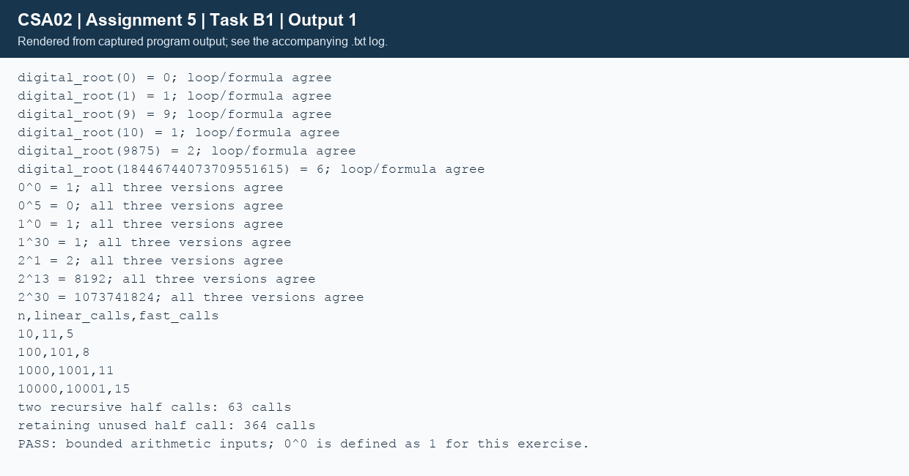

## Task B1 - Instrumented recursion (7 marks)
### B1.1/B1.2 - Correctness and relation to the design
The C functions follow A2's base cases and single-child halving pseudocode. The instrumentation increments a counter on entry, including the base case. Digit summation stays iterative inside recursive `digital_root`. Numeric tests deliberately stay within long long range; base 1 isolates recursion cost for large exponents without signed overflow.

| Test | Actual result | What it checks |
|---|---|---|
| digital_root(0), (1), (9) | 0, 1, 9 | Single-digit/zero base case |
| digital_root(10) | 1 | First multi-digit input |
| digital_root(9875) | 2 | Repeated digit-sum recursion |
| digital_root(ULLONG_MAX) | 6 | Full 64-bit unsigned input; loop/formula agree |
| 0^0, 0^5 | 1, 0 | Stated zero-exponent convention and zero base |
| 1^0, 1^30 | 1, 1 | Identity/base cases |
| 2^1, 2^13, 2^30 | 2, 8192, 1073741824 | Odd/even exponents and the supplied example |

Linear, halving and iterative power agree for every numerical case. `TaskB1/complete_code.c` fills only the supplied TODO region; its two output lines match the assignment exactly.
```text
linear: 1073741824 in 31 calls
fast  : 1073741824 in 6 calls
```
### B1.3 - Measured recursive calls
| Exponent n (base=1) | Linear prediction/actual | Halving prediction/actual |
|---|---|---|
| 10 | 11 / 11 | 5 / 5 |
| 100 | 101 / 101 | 8 / 8 |
| 1,000 | 1,001 / 1,001 | 11 / 11 |
| 10,000 | 10,001 / 10,001 | 15 / 15 |

Replacing the cached half product with two fresh child calls gives D(0)=1, D(n)=1+2D(floor(n/2)): for n=30 the actual count is 63, versus 6 when reusing half. Its recursion tree has six levels; total nodes are 1+2+4+8+16+32. Time becomes O(n), while maximum stack depth remains O(log n).

If the original `half=power_fast(...)` statement is retained but no longer used, the literal edit calls the child three times per non-base frame: T(n)=1+3T(floor(n/2)). Actual count is 364=1+3+9+27+81+243; time is O(n^(log2 3)). Both interpretations were executed explicitly to resolve the wording of the question.
### B1.4 - Controlled recursion limit
`stack_probe.c` was compiled with -O0 -fno-optimize-sibling-calls -fno-inline. A child shell had a 1024 KiB stack and core dumps disabled. Inputs doubled from 1000 until the first failure; base 1 avoided arithmetic overflow.
```text
Child stack limit: 1024 KiB; core dumps disabled; -O0 -fno-optimize-sibling-calls -fno-inline
recursive n=1000 result=1
exit_status=0
recursive n=2000 result=1
exit_status=0
recursive n=4000 result=1
exit_status=0
recursive n=8000 result=1
exit_status=0
recursive n=16000 result=1
exit_status=0
recursive n=32000 result=1
exit_status=0
tools/run_all.sh: line 35:  4607 Segmentation fault: 11  build/stack_probe recursive "$n"
exit_status=139
highest_tested_pass=32000 first_tested_failure=64000
iterative n=64000 result=1
iterative n=1000000 result=1
```
The largest tested passing exponent was 32,000; the first tested failure was 64,000 (segmentation fault, status 139). This brackets the limit for this build and stack setting; it is not the exact maximum or a universal C limit. Each recursive call consumes a frame until the bounded stack cannot grow further. The iterative version completed 64,000 and 1,000,000 with constant stack usage.
### Alternative: iterative square-and-multiply
```text
ALGORITHM Power_Iterative
INPUT: B and nonnegative N
OUTPUT: B raised to N
BEGIN
    result <- 1
    WHILE N > 0 DO
        IF N MOD 2 = 1 THEN result <- result * B END IF
        N <- N DIV 2
        IF N > 0 THEN B <- B * B END IF
    END WHILE
    RETURN result
END
```
Skipping the final unused square prevents unnecessary overflow at the last iteration. This is O(log n) arithmetic steps and O(1) extra space; recursive halving uses O(log n) stack, linear recursion O(n) time/stack, and a repeated-multiplication loop O(n) time/O(1) stack. All mathematical power routines require range checks or big integers if used beyond the bounded experimental inputs.



