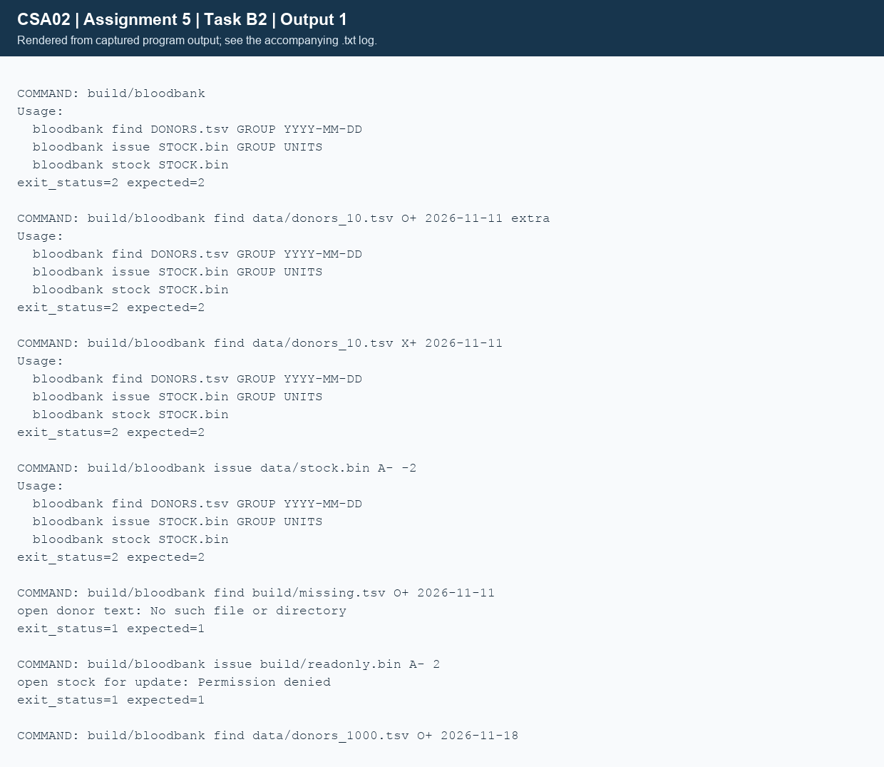
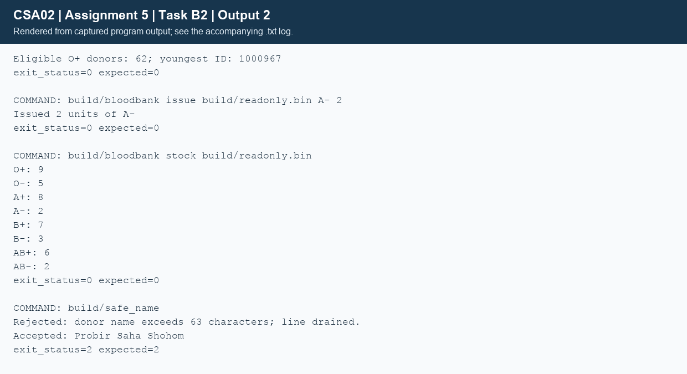

## Task B2 - Adversarial input and memory checks (5 marks)
### Long names: failure and correction
`long_name.txt` contains 200 X characters, followed by `Probir Saha Shohom` on a separate line. The intentionally unsafe program has `char name[16]` and unbounded `scanf("%s",name)`. AddressSanitizer reports stack-buffer-overflow, WRITE of size 201 (including the terminator), then aborts the isolated child. The actual raw diagnostic is retained in `unsafe_asan.txt`; symbolizer warnings occurred, but the overflow class, write size and stack buffer are identified. Undefined behaviour has no reliable ordinary output, so a successful-looking unsanitized run would not prove safety.

The corrected program uses fgets through `read_line`, a 64-byte buffer and a 63-character limit. It detects a missing newline, drains the rest of an oversized physical line, reports rejection, and continues from the next line. Spaces are preserved. The observed result was:
```text
Rejected: donor name exceeds 63 characters; line drained.
Accepted: Probir Saha Shohom
exit_status=2 expected=2
```
`scanf("%15s",name)` could bound the original buffer, but still stops at spaces and leaves the remainder for later reads. fgets plus explicit overflow handling is better for full names.
### Files, command line and malformed records
| Constructed case | Actual behaviour | Interpretation |
|---|---|---|
| No command | Usage; exit 2 | No invalid argv access |
| Too many find arguments | Usage; exit 2 | Exact command arity enforced |
| Blood group X+ | Usage; exit 2 | Group rejected before file access |
| Issue quantity -2 | Usage; exit 2 | Unsigned quantity parser rejects signs |
| Missing donor file | perror: No such file or directory; exit 1 | fopen failure handled |
| Stock file chmod 444 | perror: Permission denied; exit 1 | No crash or attempted use of NULL FILE pointer |
| Restored writable file | Issued 2 units of A-; exit 0 | Valid operation succeeds |
| Invalid checksum / duplicate ID | Data error, original list retained | Transactional load ownership |
| Truncated raw binary record | Data error, original list retained | Partial final record rejected |
| Invalid date, numeric overflow, trailing text | Rejected by assertions in validation driver | Strict parser boundaries |
| INT_MAX stock + 1 | Rejected, previous value retained | Prevent signed overflow |

The mutation tests use copies under build/, leaving delivered input fixtures unchanged. Output includes the exact command and its expected/actual exit code. The 1000-donor valid find returned 62 O+ donors by 2026-11-18, youngest ID 1000967.
### Sanitizer result and ownership limits
The corrected input reader, validation driver, registration/donation driver and 100,000-donor report were compiled with `-fsanitize=address,undefined -fno-omit-frame-pointer`. They completed without ASan/UBSan memory diagnostics. `UBSAN_OPTIONS=halt_on_error=1` made any undefined-behaviour diagnostic fatal. Donor allocation counters returned to zero, including temporary lists rejected during file loading. An extra regression checks appending a donor whose input pointer aliases the old allocation across realloc; copying it first prevents a dangling input pointer.

LeakSanitizer was disabled on this macOS run (`ASAN_OPTIONS=detect_leaks=0`), so this is not a Valgrind/LeakSanitizer proof that every possible allocation is leak-free. Explicit ownership counters cover every donor-list allocation used by these tests, and all opened files are closed. Raw logs are provided rather than a fabricated leak summary.
### Alternative: getline
```text
ALGORITHM Read_With_Getline
INPUT: open stream F
OUTPUT: validated donor name or error
BEGIN
    line <- NULL; capacity <- 0
    length <- GETLINE(ADDRESS(line), ADDRESS(capacity), F)
    IF length < 0 THEN FREE(line); RETURN failure END IF
    REMOVE trailing newline if present
    VALIDATE permitted name length and characters
    COPY validated name into the donor record
    FREE(line)
END
```
getline is POSIX, not ISO C11. It accepts/reallocates a heap buffer and includes the newline in the returned length. The caller owns that buffer and must free it even after an error if allocated. Reading length L costs O(L) time and O(L) heap capacity; fgets with fixed capacity K uses O(K) storage, and rejecting/draining a long line still costs O(L) time. getline avoids truncation but needs an application limit for untrusted, arbitrarily long input. The fixed Donor.name field still requires validation or a separate dynamically allocated representation.





