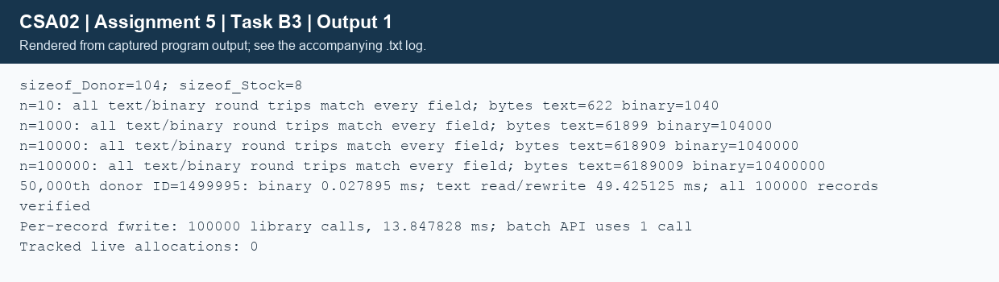

## Task B3 - Text versus binary experiments (8 marks)
### B3.1 - Small-data correctness
Ten generated synthetic donors were saved and loaded in both formats. Every logical field matched: ID, name, group, age, phone, all date components and hospital. Comparison is field-by-field using `same_donor`, not memcmp over padding bytes. Both 10-record fixtures are included under data/. Text occupied 622 bytes; raw binary occupied 1040 bytes (10 x sizeof(Donor)=104). Three repetitions passed for each format and each larger size.
### B3.2 - Size and timing results
The same deterministic generator creates 1000, 10,000 and 100,000 records. Each timed write includes open, write and close; each read includes parsing/validation and growing the destination list. Generation and fieldwise comparison are outside the timed interval. The C11 timespec_get clock records elapsed wall time. The table reports the median of three runs; all raw observations are in `TaskB3/measurements.csv`. Runs reuse the filesystem cache and do not call fsync, so these are application-level measurements, not guaranteed durable disk throughput.

| Donors | Format | File bytes | Median write (ms) | Median read (ms) |
|---|---|---|---|---|
| 1,000 | text | 61,899 | 0.658035 | 0.867844 |
| 1,000 | binary | 104,000 | 0.087023 | 0.506878 |
| 10,000 | text | 618,909 | 4.996061 | 4.621983 |
| 10,000 | binary | 1,040,000 | 0.232220 | 2.533913 |
| 100,000 | text | 6,189,009 | 20.752907 | 27.849197 |
| 100,000 | binary | 10,400,000 | 1.066923 | 18.640041 |

Text is smaller here because fixed 64-byte name storage, other fixed fields and padding are written in every binary record, while the synthetic names use fewer characters. Binary was faster in these measurements because it avoids decimal formatting/parsing, although both readers still validate each record. Both are O(n) for full write/read; observed constant factors depend on fields, compiler, storage and cache state.
### B3.3 - Update the 50,000th record
The 50,000th record is zero-based index 49,999, ID 1499995. Its age was increased by one (49 to 50), leaving eligibility unchanged. Binary uses byte offset 49,999 x 104 = 5,199,896. Text loads all records, modifies the same record, writes a temporary text file and renames it. Timing is intentionally end-to-end for each strategy; opening, closing and the text rewrite are included.

Measured binary update: **0.027895 ms**. Measured text read/rewrite: **49.425125 ms**. This update was measured once per strategy; very short timings have proportionally larger noise. Every field of all 100,000 records was compared after reloading both files, verifying the changed target and unchanged neighbours/record count.


### Completed stock code and invalid index
`TaskB3/complete_code.c` fills the supplied TODO with seek, one-record read, change, relative seek and one-record write. Its test output is:
```text
update record 3: done
update record 9: failed
1:40 2:25 3:12 4:20 5:30
```
Index 3 selects the fourth record, group code 4. Seeking beyond the end for index 9 can succeed, but fread cannot obtain a complete record and returns zero. The function exits before fwrite, so the seek alone does not extend or alter the file; the final five printed records confirm it. The supplied exercise's main is retained, including its unchecked initial fwrite/fclose; the reusable module adds I/O checks and bounded offsets. The exercise runs with small, valid offsets on the measured 64-bit long ABI.
### B3.4 - Recommendation and fwrite alternative
Use versioned, validated text for donor exchange/auditing; it is readable and portable across endianness/ABI changes. Use binary fixed records for fast local stock updates in this exercise, but define an explicit byte-level wire format (integer widths, endianness, version, checksums) or use a transactional database for production. Raw structure layout is not a portable standard: padding can vary, and file corruption is not detected merely by a successful fread.

For an array already in memory, `fwrite(records,sizeof records[0],n,fp)` uses one library call; looping over records uses n library calls. Both transfer O(n) bytes and take O(n) total time, but batching reduces per-call overhead. Library-call count is not the same as operating-system write count because stdio buffers output. The array needs O(n) RAM; streaming one record at a time needs O(1) record RAM, while a batch of b records needs O(b). In the measured 100,000-record per-record variant, all fields matched after reload; its actual time is retained in output.txt. Because this extra run followed the earlier benchmarks, it is an illustration rather than a controlled standalone performance study.



