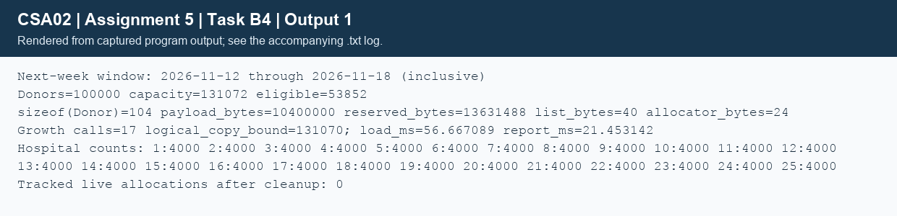

## Task B4 - Scalable nightly reporting and decision (5 marks)
### B4.1 - Practical strategy
The brief gives no numerical present-day donor count, so the experiment declares a baseline of 1000 district donors and scales it by 100 to 100,000 total across 25 hospitals (4000 each). These are synthetic fixtures, not personal medical records. The report uses the same growable-list algorithm as the completed exercise, extended with name, age, phone, date and hospital fields needed by the case study.

For reporting day 2026-11-11, the next-week window is 2026-11-12 through 2026-11-18 inclusive. Include any donor who satisfies the demonstration rule on at least one day of that window, including those already eligible before it starts. The first eligible date printed is max(last donation + 90 days, window start). Age is held at its recorded value because the brief provides age rather than date of birth. Blood groups are exact labels; this program does not implement clinical compatibility rules.
```text
ALGORITHM Next_Week_Report
INPUT: donor text path P, valid reporting date T, output path R
OUTPUT: next-week report and measurements
BEGIN
    L <- empty growable list
    LOAD validated donors from P into L
    start <- T + 1 day; finish <- T + 7 days
    OPEN R; WRITE column header
    FOR each donor D in L DO
        IF Eligible_On(D, finish) THEN
            eligible_date <- MAX(D.last + 90 days, start)
            WRITE D.id, group, age, hospital and eligible_date
        END IF
    END FOR
    CHECK output close; PRINT capacity, bytes and elapsed times
    FREE L.data; RESET L
END
```
Expected count follows independently from the generator: last donation is i MOD 180 days ago; eligibility by day+7 requires i MOD 180 >=83. Each full block contributes 97 records. For 100,000 records, 555 full blocks plus 100 remaining records give 555 x 97 + 17 = **53,852**. The generated report's exact ID sequence and date bounds were independently checked against that rule.

| Quantity | Actual measured result |
|---|---|
| Records / capacity | 100,000 / 131,072 |
| Eligible in next-week window | 53,852 |
| sizeof(Donor) | 104 bytes |
| Logical record payload | 10,400,000 bytes (9.92 MiB) |
| Reserved donor array | 13,631,488 bytes (13.00 MiB) |
| DonorList / allocator bookkeeping | 40 / 24 bytes |
| Growth calls / potential record copies | 17 / 131,070 |
| Text load elapsed | 56.667089 ms |
| Report scan and output elapsed | 21.453142 ms |
| Tracked donor allocations after free | 0 |

Reserved array bytes are capacity x sizeof(Donor), not total process RSS. Stack objects, allocator metadata, stdio buffers and executable/sanitizer overhead are not included. During a moving realloc both old and new allocations may temporarily exist. The report has O(n) scanning time, O(k) output for k matches and O(n) reserved RAM. Measurements are a single non-sanitized run; the sanitizer run is slower and is reported separately in its log.
### Completed growable list and failure handling
```text
added 7001 (O+): size = 1, capacity = 2
added 7002 (A+): size = 2, capacity = 2
added 7003 (B-): size = 3, capacity = 4
added 7004 (AB+): size = 4, capacity = 4
added 7005 (O-): size = 5, capacity = 8
```
`TaskB4/complete_code.c` replaces only the TODO region. A temporary p receives realloc so allocation failure cannot erase the old pointer. The supplied small demonstration main does not check add_donor's return value; it succeeded for five records here. The extended list used by the report checks all appends, caps size, guards byte multiplication and cleans partial loads. The capacity sequence confirms reuse of spare slots and doubling only when full.
### B4.2 - Memory check
The full report also ran under AddressSanitizer and UndefinedBehaviorSanitizer with 100,000 records, returned zero, emitted no diagnostics and ended with zero tracked live donor allocations. Its TSV output matched the non-sanitized report byte-for-byte. Raw evidence is in `TaskB2/sanitizer_output.txt`; the ownership/leak-detection scope is explained in B2. All output streams were closed and the loaded list freed on the exercised paths.
### B4.3 - Production choice and sorted index alternative
At the measured 100,000 records, a 13 MiB array and roughly 78 ms combined load/report time are affordable on this machine. Keep the growable-list implementation for this assignment and for repeated queries within a modest dataset. For a single nightly pass as the network grows, prefer streaming/batched validation and report output: it remains O(n) time but caps RAM at O(b), and does not need all donors simultaneously. A real 25-hospital service also needs coordinated unique IDs, concurrent transactions, audit/recovery and a specified clinical policy.

A separate index of fixed records `{donor_id, file_offset}` sorted by ID permits binary search:
```text
ALGORITHM Lookup_Indexed_Donor
INPUT: ID, sorted index stream I of N entries, donor stream D
OUTPUT: donor or not-found
BEGIN
    low <- 0; high <- N - 1
    WHILE low <= high DO
        mid <- low + (high - low) DIV 2
        SEEK I to mid * SIZEOF(IndexEntry); READ entry
        IF entry.id = ID THEN
            SEEK D to entry.offset; READ donor; RETURN donor
        ELSE IF entry.id < ID THEN low <- mid + 1
        ELSE high <- mid - 1
        END IF
    END WHILE
    RETURN not-found
END
```
The index uses O(n) disk storage and O(1) working RAM per lookup, with O(log n) index-record reads plus one donor read. Building an index from unsorted records costs O(n log n) comparison sorting and offsets must be rebuilt/maintained when variable-length text records move. Corrupt/stale offsets require validation. Disk seeks can dominate constants.

Loading an array does **not** automatically make arbitrary donor-ID lookup O(1). An unsorted array needs O(n) search; this ID-sorted list can use O(log n) binary search. O(1) access applies to a known array index, or expected O(1) lookup needs an additional hash table/direct-address scheme and its memory/build cost. An ID index alone cannot answer a next-week eligibility query efficiently: the program still scans eligibility fields, or needs an additional index on eligible date (and maintained age/policy constraints). Thus batching suits the nightly report, while an ID index helps random donor retrieval.



